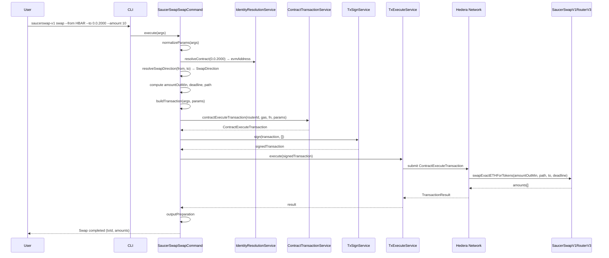
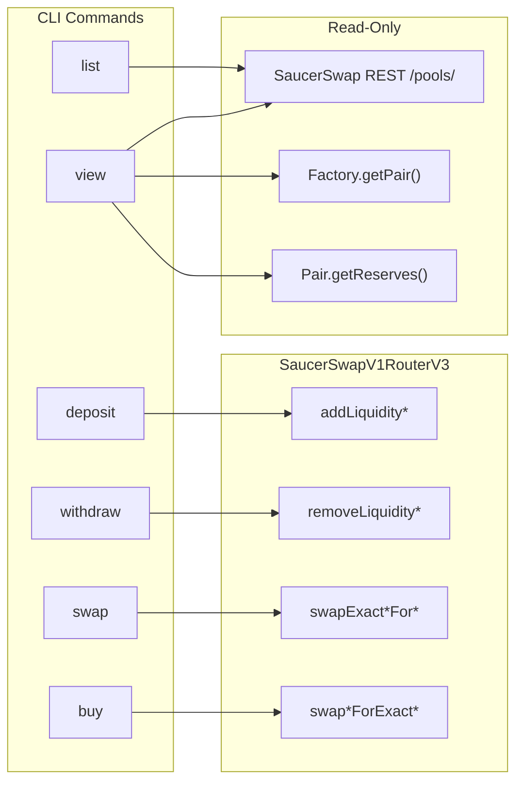

### ADR-001: SaucerSwap V1 DEX Plugin

- Status: Proposed
- Date: 2026-04-01
- Related: `src/plugins/saucerswap-v1/*`, `src/shared/services/saucerswap-api/*`, `src/shared/schemas/schemas.ts`, `src/shared/util/*`, `docs/adr/ADR-002-saucerswap-v2-dex-plugin.md`

> **Scope:** This ADR covers **SaucerSwap V1** only — a Uniswap V2-style constant-product AMM with uniform liquidity and fungible LP tokens. For the concentrated-liquidity V2 protocol (Uniswap V3-style, NFT positions, fee tiers), see [ADR-002](ADR-002-saucerswap-v2-dex-plugin.md).

## Context

;[SaucerSwap](https://www.saucerswap.finance/) is the leading decentralized exchange (DEX) on the Hedera network, implementing a Uniswap V2-style constant-product AMM. The CLI already supports generic smart contract interactions, but these require users to manually construct `ContractFunctionParameters` and know the exact Solidity function signatures. For DEX operations — which involve multi-step workflows (token association, spender allowance, liquidity management, swaps) — a dedicated plugin with domain-specific commands significantly reduces friction and error potential.

The SaucerSwap V1 protocol exposes its functionality through two on-chain contracts and a public REST API:

| Component                | Mainnet ID                                                                                                 | Purpose                                                                |
| ------------------------ | ---------------------------------------------------------------------------------------------------------- | ---------------------------------------------------------------------- |
| **SaucerSwapV1RouterV3** | `0.0.3045981`                                                                                              | All write operations: pool creation, add/remove liquidity, swaps       |
| **UniswapV2Factory**     | `0.0.1062784`                                                                                              | Pool existence checks (`getPair`), pool creation fee (`pairCreateFee`) |
| **WHBAR**                | `0.0.1456986`                                                                                              | Wrapped HBAR token used when HBAR is one side of a pair                |
| **SaucerSwap REST API**  | `https://api.saucerswap.finance/pools/` (mainnet) / `https://test-api.saucerswap.finance/pools/` (testnet) | Read-only pool listing with metadata (requires `x-api-key` header)     |

This ADR proposes a `saucerswap-v1` plugin that wraps these contracts and API into six CLI commands, reusing the host CLI's contract transaction/query services, identity resolution, and signing/execution services, plus a shared **`SaucerSwapApiService`** under `src/shared/services/saucerswap-api/` for REST pool data (see Part 5).

Reference documentation: [SaucerSwap V1 Developer Docs](https://docs.saucerswap.finance/v/developer/saucerswap-v1/).

## Decision

### Part 1: Plugin Structure

The plugin is located at `src/plugins/saucerswap-v1/` and exposes six commands.

```
src/plugins/saucerswap-v1/
├── index.ts
├── manifest.ts
├── constants.ts
├── saucerswap-contract-resolver.ts
├── abi/
│   └── router.ts
├── utils/
│   └── resolve-swap-direction.ts
└── commands/
    ├── deposit/
    │   ├── handler.ts
    │   ├── index.ts
    │   ├── input.ts
    │   ├── output.ts
    │   └── types.ts
    ├── withdraw/
    │   ├── handler.ts
    │   ├── index.ts
    │   ├── input.ts
    │   ├── output.ts
    │   └── types.ts
    ├── swap/
    │   ├── handler.ts
    │   ├── index.ts
    │   ├── input.ts
    │   ├── output.ts
    │   └── types.ts
    ├── buy/
    │   ├── handler.ts
    │   ├── index.ts
    │   ├── input.ts
    │   ├── output.ts
    │   └── types.ts
    ├── list/
    │   ├── handler.ts
    │   ├── index.ts
    │   ├── input.ts
    │   └── output.ts
    └── view/
        ├── handler.ts
        ├── index.ts
        ├── input.ts
        └── output.ts
```

Shared utilities (`hbar-detection.ts`, `slippage.ts`, `deadline.ts`, etc.) live under `src/shared/util/` and are imported by both the V1 and V2 plugins. Zod schemas for API payloads and command inputs live in `src/shared/schemas/schemas.ts`.

### Part 2: Network-Specific Constants

`src/plugins/saucerswap-v1/constants.ts` stores contract IDs, API URLs, and a LP-token decimals constant. It also exports a `getSaucerSwapV1Config(network)` helper that throws `ConfigurationError` for unsupported networks.

```ts
import { ConfigurationError, SupportedNetwork } from '@hiero-ledger/hiero-cli';

export interface SaucerSwapNetworkConfig {
  routerContractId: string;
  factoryContractId: string;
  whbarTokenId: string;
  apiBaseUrl: string;
}

export const SAUCERSWAP_V1_CONFIG: Partial<
  Record<SupportedNetwork, SaucerSwapNetworkConfig>
> = {
  [SupportedNetwork.MAINNET]: {
    routerContractId: '0.0.3045981',
    factoryContractId: '0.0.1062784', // UniswapV2Factory
    whbarTokenId: '0.0.1456986',
    apiBaseUrl: 'https://api.saucerswap.finance',
  },
  [SupportedNetwork.TESTNET]: {
    routerContractId: '0.0.19264',
    factoryContractId: '0.0.9959',
    whbarTokenId: '0.0.15058',
    apiBaseUrl: 'https://test-api.saucerswap.finance',
  },
};

/** SaucerSwap V1 LP tokens are HTS tokens with 8 decimal places. */
export const LP_TOKEN_DISPLAY_DECIMALS = 8;

export function getSaucerSwapV1Config(
  network: SupportedNetwork,
): SaucerSwapNetworkConfig {
  const config = SAUCERSWAP_V1_CONFIG[network];
  if (!config) {
    throw new ConfigurationError(
      `SaucerSwap V1 is not configured for network "${network}"`,
      { context: { network } },
    );
  }
  return config;
}
```

Default gas values, slippage and deadline defaults are declared per command in the plugin manifest (see Part 6), not as top-level constants.

### Part 3: HBAR Detection and Routing

A core design concern is that SaucerSwap uses different Solidity functions depending on whether one of the tokens is HBAR (represented as WHBAR on-chain). The plugin detects this via a shared helper (`isHbar` in `src/shared/util/hbar-detection.ts`, which accepts `"HBAR"`, `"hbar"`, and the network's WHBAR token ID) and routes to the correct function variant.

The plugin-local `utils/resolve-swap-direction.ts` composes this helper into a `SwapDirection` enum (HBAR→Token, Token→HBAR, Token→Token) used by the `swap` and `buy` handlers to pick the right router function and ABI encoding.

HBAR routing affects which Solidity function is called:

| Operation          | Both tokens are HTS        | One token is HBAR                                  |
| ------------------ | -------------------------- | -------------------------------------------------- |
| Deposit            | `addLiquidity`             | `addLiquidityETH`                                  |
| Withdraw           | `removeLiquidity`          | `removeLiquidityETH`                               |
| Swap (exact input) | `swapExactTokensForTokens` | `swapExactETHForTokens` or `swapExactTokensForETH` |
| Buy (exact output) | `swapTokensForExactTokens` | `swapETHForExactTokens` or `swapTokensForExactETH` |

### Part 4: Shared Slippage, Deadline and Router-Quote Utilities

Slippage and deadline helpers are **shared across both SaucerSwap plugins** and live under `src/shared/util/`:

- `src/shared/util/slippage.ts` — `computeMinOutput(amount, slippagePercent)` and `computeMaxInput(amount, slippagePercent)` use basis-point math on `bigint` to avoid floating-point drift.
- `src/shared/util/deadline.ts` — `computeDeadline(secondsFromNow)` returns a Unix timestamp.
- `src/shared/util/hbar-detection.ts` — `isHbar(token, whbarTokenId?)`.
- `src/shared/util/contract-query-result.ts` — helpers such as `assertAmountsArray` for parsing router return values.

In addition, the V1 plugin ships a `saucerswap-contract-resolver.ts` at the plugin root that provides a thin `SaucerSwapV1Helper` class (constructed with the CLI's `ContractQueryService` and `ContractTransactionService`). It wraps the router ABI and exposes:

- `getAmountsOut(routerId, amountIn, path)` / `computeAmountOutMin(routerId, amountIn, path, slippagePercent)`
- `getAmountsIn(routerId, amountOut, path)` / `computeAmountInMax(routerId, amountOut, path, slippagePercent)`

The `buy` command uses `computeAmountInMax` to derive a sensible `amountInMax` when the user omits `--max-input`.

### Part 5: SaucerSwap REST API (shared service + shared schemas)

**Decision:** Do **not** implement a separate `saucerswap-v1-api.ts` under the plugin. SaucerSwap HTTP access and response validation live in a **shared** service under `src/shared/services/saucerswap-api/`, which is reused by both the V1 and V2 plugins.

1. **Zod schemas** — Defined in `src/shared/schemas/schemas.ts`, e.g.:
   - `SaucerSwapApiKeySchema` (required for API calls)
   - `SaucerSwapV1ApiTokenSchema`, `SaucerSwapV1ApiLpTokenSchema`, `SaucerSwapV1ApiLiquidityPoolSchema`
   - `SaucerSwapV1ApiLiquidityPoolArraySchema`
   - Inferred types: `SaucerSwapV1ApiLiquidityPool`, etc.

2. **Service interface** — `src/shared/services/saucerswap-api/saucerswap-api-service.interface.ts` defines `SaucerSwapApiService`. The V1 surface is:
   - `fetchAllPools(apiBaseUrl, apiKey): Promise<SaucerSwapV1ApiLiquidityPool[]>` — `GET {apiBaseUrl}/pools/` with `x-api-key` header
   - `findV1PoolForTokenPair(apiBaseUrl, apiKey, tokenIdA, tokenIdB): Promise<SaucerSwapV1ApiLiquidityPool | null>` — order-independent helper used by `view` and other flows

3. **Implementation** — `src/shared/services/saucerswap-api/saucerswap-api-service.ts` (`SaucerSwapApiServiceImpl`): calls `fetch` with the `x-api-key` header, throws `NetworkError` on non-OK responses, validates JSON with `parseWithSchema` using the schemas from `src/shared/schemas/schemas.ts`.

4. **Plugins** — `saucerswap-v1` commands receive the service from the host CLI and call `saucerSwapApi.fetchAllPools(config.apiBaseUrl, apiKey)` / `findV1PoolForTokenPair(...)` (no duplicate fetch logic in the plugin). The API key is supplied by the user via the `--api-key` CLI option on `list`/`view`.

Illustrative shape:

```ts
// src/shared/services/saucerswap-api/saucerswap-api-service.interface.ts
import type {
  SaucerSwapV1ApiLiquidityPool,
  SaucerSwapV2ApiPool,
  SaucerSwapV2ApiPosition,
} from '@/shared/schemas/schemas';

export interface SaucerSwapApiService {
  fetchAllPools(
    apiBaseUrl: string,
    apiKey: string,
  ): Promise<SaucerSwapV1ApiLiquidityPool[]>;

  /** Fetches all V1 pools and returns the one whose pair matches the two token IDs (order-independent). */
  findV1PoolForTokenPair(
    apiBaseUrl: string,
    apiKey: string,
    tokenIdA: string,
    tokenIdB: string,
  ): Promise<SaucerSwapV1ApiLiquidityPool | null>;

  // V2 methods (pools / positions) live on the same service — see ADR-002.
  fetchV2Pools(
    apiBaseUrl: string,
    apiKey: string,
  ): Promise<SaucerSwapV2ApiPool[]>;
  fetchV2Positions(
    apiBaseUrl: string,
    accountId: string,
    apiKey: string,
  ): Promise<SaucerSwapV2ApiPosition[]>;
}
```

### Part 6: Commands

#### 6.1 Deposit (Add Liquidity)

`saucerswapV1Deposit` is a handler registered via the manifest. Adds liquidity to an **existing** pool.

**Solidity functions:**

- HBAR/token: `addLiquidityETH(address token, uint amountTokenDesired, uint amountTokenMin, uint amountETHMin, address to, uint deadline)`
- Token/token: `addLiquidity(address tokenA, address tokenB, uint amountADesired, uint amountBDesired, uint amountAMin, uint amountBMin, address to, uint deadline)`

**CLI options:**

| Option          | Short | Type   | Required | Default     | Description                                                       |
| --------------- | ----- | ------ | -------- | ----------- | ----------------------------------------------------------------- |
| `--token-a`     | `-a`  | STRING | yes      | —           | First token (Hedera ID, alias, EVM address, or `HBAR`)            |
| `--token-b`     | `-b`  | STRING | yes      | —           | Second token                                                      |
| `--amount-a`    |       | STRING | yes      | —           | Desired amount of token A (display units, or raw with `t` suffix) |
| `--amount-b`    |       | STRING | yes      | —           | Desired amount of token B                                         |
| `--slippage`    | `-s`  | NUMBER | no       | `0.5`       | Slippage tolerance (%)                                            |
| `--deadline`    | `-d`  | NUMBER | no       | `180`       | Deadline in seconds                                               |
| `--gas`         | `-g`  | NUMBER | no       | `1_000_000` | Gas limit                                                         |
| `--key-manager` | `-k`  | STRING | no       | —           | Key manager                                                       |

CLI usage:

```
hcli saucerswap-v1 deposit --token-a HBAR --token-b 0.0.2000 --amount-a 10 --amount-b 5000
hcli saucerswap-v1 deposit --token-a 0.0.2000 --token-b 0.0.3000 --amount-a 100 --amount-b 200
```

**Pre-checks:**

1. LP token must be associated to the client account.
2. Router contract must have spender allowance for the input HTS tokens.

#### 6.2 Withdraw (Remove Liquidity)

`saucerswapV1Withdraw` handler. Removes liquidity from an existing pool.

**Solidity functions:**

- HBAR/token: `removeLiquidityETH(address token, uint liquidity, uint amountTokenMin, uint amountETHMin, address to, uint deadline)`
- Token/token: `removeLiquidity(address tokenA, address tokenB, uint liquidity, uint amountAMin, uint amountBMin, address to, uint deadline)`

LP liquidity amounts default to 8 decimals (`LP_TOKEN_DISPLAY_DECIMALS`); raw base units can be passed with the `t` suffix.

**CLI options:**

| Option           | Short | Type   | Required | Default     | Description                                |
| ---------------- | ----- | ------ | -------- | ----------- | ------------------------------------------ |
| `--token-a`      | `-a`  | STRING | yes      | —           | First token                                |
| `--token-b`      | `-b`  | STRING | yes      | —           | Second token                               |
| `--liquidity`    | `-l`  | STRING | yes      | —           | LP token amount to remove (display or `t`) |
| `--min-amount-a` |       | STRING | no       | —           | Minimum token A returned                   |
| `--min-amount-b` |       | STRING | no       | —           | Minimum token B returned                   |
| `--deadline`     | `-d`  | NUMBER | no       | `180`       | Deadline seconds                           |
| `--gas`          | `-g`  | NUMBER | no       | `2_800_000` | Gas limit                                  |
| `--key-manager`  | `-k`  | STRING | no       | —           | Key manager                                |

**Pre-checks:** Router contract must have spender allowance for the LP token.

CLI usage:

```
hcli saucerswap-v1 withdraw --token-a HBAR --token-b 0.0.2000 --liquidity 1000000
hcli saucerswap-v1 withdraw --token-a 0.0.2000 --token-b 0.0.3000 --liquidity 500000
```

#### 6.3 Swap (Exact Input)

`saucerswapV1Swap` handler. Swaps an exact amount of input token for at least a minimum amount of output token.

**Solidity functions (selected by `SwapDirection` resolved in `utils/resolve-swap-direction.ts`):**

| Input | Output | Function                                                                                                |
| ----- | ------ | ------------------------------------------------------------------------------------------------------- |
| HBAR  | Token  | `swapExactETHForTokens(uint amountOutMin, address[] path, address to, uint deadline)`                   |
| Token | HBAR   | `swapExactTokensForETH(uint amountIn, uint amountOutMin, address[] path, address to, uint deadline)`    |
| Token | Token  | `swapExactTokensForTokens(uint amountIn, uint amountOutMin, address[] path, address to, uint deadline)` |

**CLI options:**

| Option          | Short | Type   | Required | Default     | Description                                                |
| --------------- | ----- | ------ | -------- | ----------- | ---------------------------------------------------------- |
| `--from`        | `-f`  | STRING | yes      | —           | Input token (Hedera ID, alias, EVM address, or `HBAR`)     |
| `--to`          | `-t`  | STRING | yes      | —           | Output token                                               |
| `--amount`      | `-a`  | STRING | yes      | —           | Exact input amount (display units, or raw with `t` suffix) |
| `--min-output`  | `-m`  | STRING | no       | —           | Minimum output amount; overrides slippage when set         |
| `--slippage`    | `-s`  | NUMBER | no       | `0.5`       | Slippage tolerance (%) used when `--min-output` omitted    |
| `--deadline`    | `-d`  | NUMBER | no       | `180`       | Deadline seconds                                           |
| `--gas`         | `-g`  | NUMBER | no       | `1_000_000` | Gas limit                                                  |
| `--key-manager` | `-k`  | STRING | no       | —           | Key manager                                                |

**Path construction:** The `path` parameter is an ordered array of EVM addresses. For a direct swap: `[fromEvmAddress, toEvmAddress]`. When HBAR is involved, the WHBAR EVM address is substituted into the path.

**Swap direction enum** (defined in `utils/resolve-swap-direction.ts`):

```ts
export enum SwapDirection {
  HBAR_FOR_TOKEN = 'HBAR_FOR_TOKEN',
  TOKEN_FOR_HBAR = 'TOKEN_FOR_HBAR',
  TOKEN_FOR_TOKEN = 'TOKEN_FOR_TOKEN',
}
```

`resolveSwapDirection` uses the shared `isHbar` helper (which also recognises the network's WHBAR token ID) to pick the direction, and the handler dispatches on it to select the correct router function name and `ContractFunctionParameters` layout.

**Pre-checks:**

1. Output token must be associated to the recipient account.
2. Router contract must have spender allowance for the input token (when input is not HBAR).

CLI usage:

```
hcli saucerswap-v1 swap --from HBAR --to 0.0.2000 --amount 10 --slippage 1
hcli saucerswap-v1 swap --from 0.0.2000 --to 0.0.3000 --amount 500 --min-output 480
hcli saucerswap-v1 swap --from 0.0.2000 --to HBAR --amount 1000
```

#### 6.4 Buy (Exact Output)

`saucerswapV1Buy` handler. The inverse of `swap` — the user specifies the **exact output** amount they want to receive. If `--max-input` is omitted, the handler derives it from `router.getAmountsIn(...)` padded by `--slippage` via `SaucerSwapV1Helper.computeAmountInMax`.

**Solidity functions:**

| Input | Output | Function                                                                                                |
| ----- | ------ | ------------------------------------------------------------------------------------------------------- |
| HBAR  | Token  | `swapETHForExactTokens(uint amountOut, address[] path, address to, uint deadline)`                      |
| Token | HBAR   | `swapTokensForExactETH(uint amountOut, uint amountInMax, address[] path, address to, uint deadline)`    |
| Token | Token  | `swapTokensForExactTokens(uint amountOut, uint amountInMax, address[] path, address to, uint deadline)` |

**CLI options:**

| Option          | Short | Type   | Required | Default     | Description                                                                          |
| --------------- | ----- | ------ | -------- | ----------- | ------------------------------------------------------------------------------------ |
| `--from`        | `-f`  | STRING | yes      | —           | Input token                                                                          |
| `--to`          | `-t`  | STRING | yes      | —           | Output token                                                                         |
| `--amount`      | `-a`  | STRING | yes      | —           | Exact output amount desired                                                          |
| `--max-input`   | `-m`  | STRING | no       | —           | Maximum input to spend. When omitted, computed via `router.getAmountsIn` + slippage. |
| `--slippage`    | `-s`  | NUMBER | no       | `0`         | Slippage tolerance (%) used when `--max-input` omitted                               |
| `--deadline`    | `-d`  | NUMBER | no       | `180`       | Deadline seconds                                                                     |
| `--gas`         | `-g`  | NUMBER | no       | `1_000_000` | Gas limit                                                                            |
| `--key-manager` | `-k`  | STRING | no       | —           | Key manager                                                                          |

CLI usage:

```
hcli saucerswap-v1 buy --from HBAR --to 0.0.2000 --amount 5000 --max-input 15
hcli saucerswap-v1 buy --from 0.0.2000 --to HBAR --amount 10 --max-input 6000
hcli saucerswap-v1 buy --from HBAR --to 0.0.2000 --amount 5000 --slippage 1   # auto-cap via getAmountsIn
```

#### 6.5 List Pools

`saucerswapV1List` is a read-only handler (no transaction). It queries the SaucerSwap REST API via the shared `SaucerSwapApiService` and optionally filters the result.

**CLI options:**

| Option      | Short | Type   | Required | Description                                                        |
| ----------- | ----- | ------ | -------- | ------------------------------------------------------------------ |
| `--api-key` |       | STRING | yes      | SaucerSwap API key (sent as `x-api-key` header)                    |
| `--token`   | `-t`  | STRING | no       | Filter pools containing this token (ID, symbol, or name substring) |

Handler flow (sketch):

```ts
const { apiKey, token } = SaucerSwapV1ListInputSchema.parse(args.args);
const config = getSaucerSwapV1Config(currentNetwork);
const pools = await saucerSwapApi.fetchAllPools(config.apiBaseUrl, apiKey);
const filtered = token ? filterPoolsByToken(pools, token) : pools;
```

CLI usage:

```
hcli saucerswap-v1 list --api-key $SAUCERSWAP_API_KEY
hcli saucerswap-v1 list --api-key $SAUCERSWAP_API_KEY --token 0.0.2000
hcli saucerswap-v1 list --api-key $SAUCERSWAP_API_KEY --token SAUCE
```

#### 6.6 View Pool

`saucerswapV1View` is a read-only handler. It shows detailed information about a specific pool identified by its two tokens, using the shared API service's `findV1PoolForTokenPair` helper.

**CLI options:**

| Option      | Short | Type   | Required | Description                                     |
| ----------- | ----- | ------ | -------- | ----------------------------------------------- |
| `--api-key` |       | STRING | yes      | SaucerSwap API key (sent as `x-api-key` header) |
| `--token-a` | `-a`  | STRING | yes      | First token                                     |
| `--token-b` | `-b`  | STRING | yes      | Second token                                    |

**Data sources:**

1. `SaucerSwapApiService.findV1PoolForTokenPair(apiBaseUrl, apiKey, tokenIdA, tokenIdB)` — returns the pool whose pair matches, order-independent.
2. Optionally, `factory.getPair(tokenA, tokenB)` via the CLI's `ContractQueryService` for on-chain confirmation.

**Output includes:** pool contract ID, LP token ID (when listed), token A/B symbols, and reserves.

CLI usage:

```
hcli saucerswap-v1 view --api-key $SAUCERSWAP_API_KEY --token-a HBAR --token-b 0.0.2000
hcli saucerswap-v1 view --api-key $SAUCERSWAP_API_KEY --token-a 0.0.2000 --token-b 0.0.3000
```

### Part 7: Command Classification

| Command    | Type                | On-Chain Effect                                       | SaucerSwap Contract Function             |
| ---------- | ------------------- | ----------------------------------------------------- | ---------------------------------------- |
| `deposit`  | transaction handler | Adds liquidity to existing pool                       | `addLiquidityETH` / `addLiquidity`       |
| `withdraw` | transaction handler | Removes liquidity from existing pool                  | `removeLiquidityETH` / `removeLiquidity` |
| `swap`     | transaction handler | Swaps exact input for minimum output                  | `swapExact*For*` variants                |
| `buy`      | transaction handler | Swaps maximum input for exact output                  | `swap*ForExact*` variants                |
| `list`     | read-only handler   | None (REST API query)                                 | N/A                                      |
| `view`     | read-only handler   | None (REST API query; optional on-chain confirmation) | Factory `getPair` (optional)             |

## Execution Flow

### Swap Lifecycle



### Command-to-Contract Mapping



## Pros and Cons

### Pros

- **Minimal host-CLI surface.** The plugin reuses the host CLI's `ContractTransactionService`, `ContractQueryService`, `IdentityResolutionService`, `TxSignService`, and `TxExecuteService`. REST pool access uses a shared **`SaucerSwapApiService`** under `src/shared/services/saucerswap-api/` with Zod schemas in `src/shared/schemas/schemas.ts`, so HTTP and validation stay in one place rather than duplicated per plugin.
- **Domain-specific UX.** Users interact with high-level concepts (swap, deposit, withdraw) rather than raw Solidity function names and hex-encoded parameters. The plugin handles HBAR/WHBAR routing, slippage computation, deadline calculation, and path construction automatically.
- **Follows established patterns.** Write commands are transaction handlers (compatible with batch/schedule hooks), read-only commands are plain handlers. The file structure mirrors other plugins.
- **Testable.** Each command handler is independently unit-testable by mocking the contract services, identity resolution, and `SaucerSwapApiService` (e.g. `fetchAllPools`, `findV1PoolForTokenPair`).
- **Typed API responses.** The SaucerSwap REST API responses are parsed with Zod schemas in `src/shared/schemas/schemas.ts`, catching API changes at parse time rather than at runtime.

### Cons

- **External API dependency.** The `list` and `view` commands depend on SaucerSwap's REST API (`api.saucerswap.finance`), which requires an API key (passed via `--api-key`) and may have rate limits, downtime, or schema changes. The plugin should handle API errors gracefully with informative messages.
- **Network-specific configuration.** Contract IDs differ between mainnet and testnet (localnet is not supported). The plugin must validate that configuration exists for the current network before executing via `getSaucerSwapV1Config`.
- **Gas estimation.** Default gas values are declared per-command in the manifest (deposit/swap/buy: `1_000_000`, withdraw: `2_800_000`). Actual gas requirements may vary for tokens with custom fees. Users can override with `--gas`.
- **Token decimal handling.** The plugin must correctly convert human-readable amounts to smallest-unit integers using each token's decimals. An explicit `t` suffix on amount strings bypasses conversion and treats the value as raw base units.
- **Pre-check responsibility.** Token association and spender allowance must be handled by the user before invoking SaucerSwap commands.

## Consequences

- A plugin directory `src/plugins/saucerswap-v1/` with the structure described above.
- The plugin manifest (`saucerswapV1PluginManifest`) registers all six commands, their options, output schemas and Handlebars templates.
- A shared **`SaucerSwapApiService`** / **`SaucerSwapApiServiceImpl`** lives at `src/shared/services/saucerswap-api/`, with all SaucerSwap Zod schemas in `src/shared/schemas/schemas.ts`. Both V1 and V2 plugins consume this service.
- Shared utilities (`hbar-detection.ts`, `slippage.ts`, `deadline.ts`, `contract-query-result.ts`) live in `src/shared/util/` and are reused across plugins. The V1 plugin ships a local `saucerswap-contract-resolver.ts` (`SaucerSwapV1Helper`) for router quote helpers (`getAmountsOut`, `getAmountsIn`, and slippage-aware variants).
- Users must ensure token associations and spender allowances are in place before using the plugin.
- The `constants.ts` file must be updated if testnet contract IDs change.
- Multi-hop swap routing and custom-fee token variants (`*SupportingFeeOnTransferTokens`) can be added as future enhancements without changing the command structure.
- SaucerSwap V2 (concentrated liquidity, Uniswap V3-style) is covered separately in [ADR-002](ADR-002-saucerswap-v2-dex-plugin.md). The two plugins coexist as `saucerswap-v1` and `saucerswap-v2`.

## Testing Strategy

- **Unit: `saucerswapV1Swap`.** Test HBAR→Token, Token→HBAR, and Token→Token inputs; verify correct Solidity function selection via `resolveSwapDirection`, WHBAR substitution in the path, and that `contractExecuteTransaction` is called with the right `functionName`, `contractId`, `gas`, and `payableAmount` (HBAR only).
- **Unit: `saucerswapV1Buy`.** Verify "exact output" function variants (`swap*ForExact*`) are selected and `amountInMax` / `amountOut` are placed correctly. When `--max-input` is omitted, verify `SaucerSwapV1Helper.computeAmountInMax` is used.
- **Unit: `saucerswapV1Deposit`.** Verify `addLiquidity` vs `addLiquidityETH` routing and that slippage computation produces correct `amountMin` values.
- **Unit: `saucerswapV1Withdraw`.** Verify `removeLiquidity` vs `removeLiquidityETH` routing. Verify LP amount and minimum output amounts are correctly passed.
- **Unit: `saucerswapV1List`.** Mock `SaucerSwapApiService.fetchAllPools` and verify filtering by token ID, symbol, and name substring. Verify empty result handling.
- **Unit: `saucerswapV1View`.** Mock `findV1PoolForTokenPair` for order-independent lookup; verify the output includes reserves and LP token info.
- **Unit: HBAR detection.** Test `isHbar` with `HBAR`, `hbar`, the WHBAR token ID for the current network, and regular token IDs.
- **Unit: Slippage and deadline utilities.** Test `computeMinOutput` / `computeMaxInput` across amounts and slippage percentages. Test `computeDeadline` produces correct Unix timestamp.
- **Unit: `SaucerSwapV1Helper`.** Mock the contract query/transaction services and verify `getAmountsOut` / `getAmountsIn` decode router replies via the ABI and that the `compute*Min/Max` helpers apply slippage in basis points.
- **Unit: `SaucerSwapApiServiceImpl`.** Mock `fetch` and verify Zod parsing via `schemas.ts`, the `x-api-key` header is set, and `NetworkError` is thrown on non-200 responses.
- **Unit: Constants.** Verify config exists for mainnet and testnet. Verify `getSaucerSwapV1Config` throws `ConfigurationError` for unsupported networks.
- **Integration: Swap lifecycle.** With mocked network, verify full flow from CLI args through parameter normalisation → transaction build → sign → execute → output preparation.
