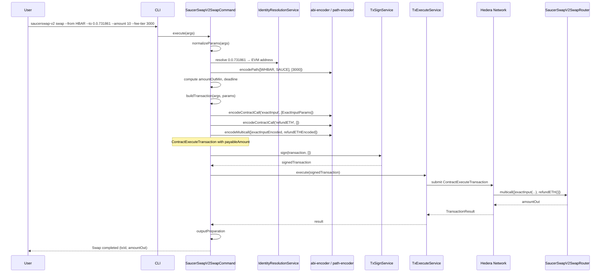
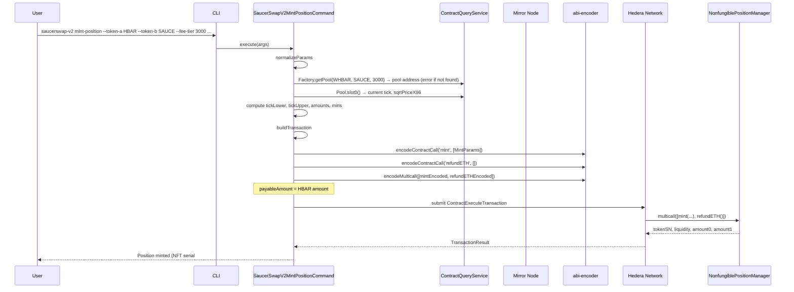
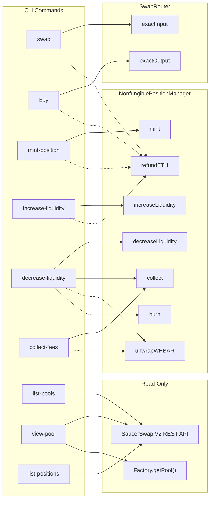

### ADR-002: SaucerSwap V2 Concentrated Liquidity Plugin

- Status: Proposed
- Date: 2026-04-09
- Related: `src/plugins/saucerswap-v2/*`, `src/shared/services/saucerswap-api/*`, `src/shared/schemas/schemas.ts`, `src/shared/util/*`, `docs/adr/ADR-001-saucerswap-v1-dex-plugin.md`

## Context

[ADR-001](ADR-001-saucerswap-v1-dex-plugin.md) introduced a `saucerswap-v1` plugin for SaucerSwap **V1** — a Uniswap V2-style constant-product AMM with uniform liquidity, fungible LP tokens, and named Solidity functions (`addLiquidity`, `swapExactTokensForTokens`, etc.) callable via the Hedera SDK's `ContractFunctionParameters`.

[SaucerSwap V2](https://docs.saucerswap.finance/protocol/saucerswap-v2) is a fundamentally different protocol based on the **Uniswap V3 concentrated-liquidity** model, adapted for the Hedera Token Service (HTS). It introduces:

1. **Concentrated liquidity** — LPs allocate capital within specific price ranges (tick intervals), achieving up to 4,000x capital efficiency versus V1.
2. **Fee tiers** — Each token pair can have multiple pools at different fee levels (0.05%, 0.15%, 0.30%, 1.00%).
3. **NFT-based positions** — Each liquidity position is unique (tick range + fee tier) and represented by a non-fungible HTS token, not a fungible LP token.
4. **ABI-encoded parameters** — V2 contracts accept complex Solidity structs (`ExactInputParams`, `MintParams`, etc.) that **cannot** be built with the Hedera SDK's `ContractFunctionParameters` helper. Calls must be ABI-encoded via `ethers.Interface.encodeFunctionData()` and submitted as raw bytes.
5. **`bytes path`** — Swap routing uses a packed bytes array (`token(20B) + fee(3B) + token(20B) + ...`) rather than V1's `address[]`.
6. **Multicall pattern** — Multiple operations are composed into a single `ContractExecuteTransaction` via the `multicall(bytes[])` function (e.g. `swap + refundETH`, or `decreaseLiquidity + collect + unwrapWHBAR + burn`).
7. **Separate contract set** — V2 uses its own SwapRouter, NonfungiblePositionManager, Factory, and QuoterV2, distinct from V1's Router and Factory.

The V2 protocol exposes its functionality through the following on-chain contracts and public REST API:

| Component                                    | Mainnet ID                                 | Testnet ID                                      | Purpose                                                                                  |
| -------------------------------------------- | ------------------------------------------ | ----------------------------------------------- | ---------------------------------------------------------------------------------------- |
| **SaucerSwapV2SwapRouter**                   | `0.0.3949434`                              | `0.0.1414040`                                   | Swap operations (`exactInput`, `exactOutput`)                                            |
| **SaucerSwapV2NonfungiblePositionManagerV2** | `0.0.4053945`                              | `0.0.1308184`                                   | Liquidity positions: `mint`, `increaseLiquidity`, `decreaseLiquidity`, `collect`, `burn` |
| **SaucerSwapV2Factory**                      | `0.0.3946833`                              | `0.0.1197038`                                   | Pool existence (`getPool`), mint fee (`mintFee`)                                         |
| **SaucerSwapV2QuoterV2**                     | `0.0.3949424`                              | `0.0.1390002`                                   | Off-chain swap quotes                                                                    |
| **LP NFT Token**                             | `0.0.4054027`                              | `0.0.1310436`                                   | HTS NFT representing liquidity positions                                                 |
| **WHBAR**                                    | `0.0.1456986`                              | `0.0.15058`                                     | Wrapped HBAR used when HBAR is one side of a pair                                        |
| **SaucerSwap V2 REST API**                   | `https://api.saucerswap.finance/v2/pools/` | `https://test-api.saucerswap.finance/v2/pools/` | Read-only V2 pool listing and position data                                              |

Reference documentation: [SaucerSwap V2 Developer Docs](https://docs.saucerswap.finance/v/developer/saucerswap-v2/), [Contract Deployments](https://docs.saucerswap.finance/developerx/contract-deployments), [V2 Whitepaper](https://www.saucerswap.finance/whitepaper-v2.pdf).

## Decision

### Part 1: Plugin Structure

The plugin is located at `src/plugins/saucerswap-v2/` and exposes nine commands.

```
src/plugins/saucerswap-v2/
├── index.ts
├── manifest.ts
├── constants.ts
├── abi/
│   ├── swap-router.ts
│   ├── nft-position-manager.ts
│   ├── factory.ts
│   └── pool.ts
├── utils/
│   ├── abi-encoder.ts
│   ├── path-encoder.ts
│   ├── multicall.ts
│   └── tick-math.ts
└── commands/
    ├── swap/
    │   ├── handler.ts
    │   ├── index.ts
    │   ├── input.ts
    │   ├── output.ts
    │   └── types.ts
    ├── buy/
    │   ├── handler.ts
    │   ├── index.ts
    │   ├── input.ts
    │   ├── output.ts
    │   └── types.ts
    ├── mint-position/
    │   ├── handler.ts
    │   ├── index.ts
    │   ├── input.ts
    │   ├── output.ts
    │   └── types.ts
    ├── increase-liquidity/
    │   ├── handler.ts
    │   ├── index.ts
    │   ├── input.ts
    │   ├── output.ts
    │   └── types.ts
    ├── decrease-liquidity/
    │   ├── handler.ts
    │   ├── index.ts
    │   ├── input.ts
    │   ├── output.ts
    │   └── types.ts
    ├── collect-fees/
    │   ├── handler.ts
    │   ├── index.ts
    │   ├── input.ts
    │   ├── output.ts
    │   └── types.ts
    ├── list-pools/
    │   ├── handler.ts
    │   ├── index.ts
    │   ├── input.ts
    │   └── output.ts
    ├── view-pool/
    │   ├── handler.ts
    │   ├── index.ts
    │   ├── input.ts
    │   └── output.ts
    └── list-positions/
        ├── handler.ts
        ├── index.ts
        ├── input.ts
        └── output.ts
```

ABI fragments are exported as `.ts` modules (typed `const` arrays of human-readable signatures) rather than `.json` files — this keeps imports type-checked and avoids the need for a JSON loader.

Shared utilities (`hbar-detection.ts`, `slippage.ts`, `deadline.ts`, `contract-query-result.ts`, `token-evm.ts`) and Zod schemas (`src/shared/schemas/schemas.ts`) are reused from the V1 plugin and live under `src/shared/`. The V2 plugin does not duplicate them.

### Part 2: Network-Specific Constants

`src/plugins/saucerswap-v2/constants.ts` stores contract IDs, LP NFT token IDs, and API URLs per network:

```ts
import { ConfigurationError, SupportedNetwork } from '@hiero-ledger/hiero-cli';
import { z } from 'zod';

export interface SaucerSwapV2NetworkConfig {
  swapRouterContractId: string;
  nftManagerContractId: string;
  factoryContractId: string;
  quoterContractId: string;
  lpNftTokenId: string;
  whbarTokenId: string;
  apiBaseUrl: string;
}

export const SAUCERSWAP_V2_CONFIG: Partial<
  Record<SupportedNetwork, SaucerSwapV2NetworkConfig>
> = {
  [SupportedNetwork.MAINNET]: {
    swapRouterContractId: '0.0.3949434',
    nftManagerContractId: '0.0.4053945',
    factoryContractId: '0.0.3946833',
    quoterContractId: '0.0.3949424',
    lpNftTokenId: '0.0.4054027',
    whbarTokenId: '0.0.1456986',
    apiBaseUrl: 'https://api.saucerswap.finance',
  },
  [SupportedNetwork.TESTNET]: {
    swapRouterContractId: '0.0.1414040',
    nftManagerContractId: '0.0.1308184',
    factoryContractId: '0.0.1197038',
    quoterContractId: '0.0.1390002',
    lpNftTokenId: '0.0.1310436',
    whbarTokenId: '0.0.15058',
    apiBaseUrl: 'https://test-api.saucerswap.finance',
  },
};

export function getSaucerSwapV2Config(
  network: SupportedNetwork,
): SaucerSwapV2NetworkConfig {
  const config = SAUCERSWAP_V2_CONFIG[network];
  if (!config) {
    throw new ConfigurationError(
      `SaucerSwap V2 is not configured for network "${network}"`,
      { context: { network } },
    );
  }
  return config;
}

export enum FeeTier {
  VERY_STABLE = 500, // 0.05%, tick spacing 10
  STABLE = 1500, // 0.15%, tick spacing 30
  STANDARD = 3000, // 0.30%, tick spacing 60
  VOLATILE = 10000, // 1.00%, tick spacing 200
}

export const FEE_TIER_TO_TICK_SPACING: Record<number, number> = {
  [FeeTier.VERY_STABLE]: 10,
  [FeeTier.STABLE]: 30,
  [FeeTier.STANDARD]: 60,
  [FeeTier.VOLATILE]: 200,
};
```

Per-command default gas, deadline and slippage values are declared in the plugin manifest options (see Part 8), not as top-level constants.

### Part 3: ABI Encoding Strategy

This is the most significant architectural difference from ADR-001. The V1 plugin builds transactions using `ContractFunctionParameters` (the Hedera SDK's named-parameter helper). V2 contracts use complex Solidity structs (`ExactInputParams`, `MintParams`, `DecreaseLiquidityParams`, etc.) that require ABI encoding.

**Decision:** The plugin performs ABI encoding within its own `utils/abi-encoder.ts` using `ethers.Interface`, which is already a dependency of the CLI (used by `ContractQueryService` and `ContractCreateFlow`). The raw `Uint8Array` is passed to `ContractExecuteTransaction.setFunctionParameters()` directly — the plugin constructs the `ContractExecuteTransaction` itself rather than going through `ContractTransactionService.contractExecuteTransaction()`, because the latter requires `functionName` + `ContractFunctionParameters` which cannot express the V2 struct calls.

```ts
// src/plugins/saucerswap-v2/utils/abi-encoder.ts
import { Interface, getBytes } from 'ethers';

export function encodeContractCall(
  abi: string | readonly string[],
  functionName: string,
  params: unknown[],
): Uint8Array {
  const iface = new Interface(abi);
  const encoded = iface.encodeFunctionData(functionName, params);
  return getBytes(encoded);
}

export function decodeContractResult(
  abi: string | readonly string[],
  functionName: string,
  data: Uint8Array,
): unknown[] {
  const iface = new Interface(abi);
  const decoded = iface.decodeFunctionResult(functionName, data);
  return [...decoded];
}
```

The ABI JSON files for each contract are stored in `src/plugins/saucerswap-v2/abi/` and contain only the function fragments needed by the plugin (not full contract ABIs). This keeps the bundle size small and avoids importing unnecessary functions.

**Why not extend `ContractTransactionService`?** Adding a `rawFunctionParameters: Uint8Array` option to `ContractExecuteParams` was considered but rejected because:

1. It would change a core interface for a single plugin's need.
2. The plugin already needs full control over `payableAmount`, multicall composition, and WHBAR handling, so it must construct `ContractExecuteTransaction` directly in several cases.
3. Keeping the encoding self-contained in the plugin avoids coupling core to ethers ABI specifics beyond what already exists in `ContractQueryService`.

### Part 4: Path Encoding

V2 swap routing uses a packed `bytes` path where each token is a 20-byte EVM address and each fee tier is a 3-byte value. The path format is `[token0(20B) | fee(3B) | token1(20B) | fee(3B) | token2(20B) | ...]`.

For `exactOutput`, the path must be **reversed** (output token first).

```ts
// src/plugins/saucerswap-v2/utils/path-encoder.ts

/**
 * Encode a V2 swap path: [token(20B) + fee(3B) + token(20B) + fee(3B) + ...]
 * Each token is an EVM address (0x-prefixed hex, 20 bytes).
 * Each fee is a uint24 (3 bytes big-endian).
 */
export function encodePath(tokens: string[], fees: number[]): string {
  if (tokens.length !== fees.length + 1) {
    throw new Error('tokens.length must equal fees.length + 1');
  }

  let path = '0x';
  for (let i = 0; i < fees.length; i++) {
    path += tokens[i].slice(2); // remove 0x prefix
    path += fees[i].toString(16).padStart(6, '0'); // 3 bytes = 6 hex chars
  }
  path += tokens[tokens.length - 1].slice(2);
  return path;
}

/**
 * Build the reversed path for exactOutput.
 */
export function encodePathReversed(tokens: string[], fees: number[]): string {
  return encodePath([...tokens].reverse(), [...fees].reverse());
}
```

### Part 5: Multicall Composition

Several V2 operations require combining multiple calls into one transaction using `multicall(bytes[])`. This applies when:

- **Swapping with HBAR input:** `[exactInput, refundETH]` — refund excess HBAR.
- **Minting a position with HBAR:** `[mint, refundETH]` — refund excess HBAR.
- **Decreasing liquidity:** `[decreaseLiquidity, collect, unwrapWHBAR?, burn?]` — collect tokens, optionally convert WHBAR to HBAR, optionally burn NFT.
- **Collecting fees with HBAR pool:** `[collect, unwrapWHBAR]` — convert WHBAR to native HBAR.

```ts
// src/plugins/saucerswap-v2/utils/multicall.ts
import { Interface, getBytes } from 'ethers';

/**
 * ABI-encode a multicall wrapping multiple encoded function calls.
 */
export function encodeMulticall(
  abi: string | readonly string[],
  encodedCalls: Uint8Array[],
): Uint8Array {
  const iface = new Interface(abi);
  const callsAsHex = encodedCalls.map(
    (c) => '0x' + Buffer.from(c).toString('hex'),
  );
  const encoded = iface.encodeFunctionData('multicall', [callsAsHex]);
  return getBytes(encoded);
}
```

### Part 6: Tick and Price Utilities

Concentrated liquidity positions require specifying a tick range. The plugin provides helpers to convert between human-readable prices and ticks, and to snap ticks to the nearest valid tick spacing.

```ts
// src/plugins/saucerswap-v2/utils/tick-math.ts

/**
 * Round a tick to the nearest usable tick given the pool's tick spacing.
 */
export function nearestUsableTick(tick: number, tickSpacing: number): number {
  const rounded = Math.round(tick / tickSpacing) * tickSpacing;
  return rounded;
}

/**
 * Compute ticks for a symmetric ±percentage range around the current tick.
 * Used by volatility strategy presets.
 */
export function tickRangeFromPercent(
  currentTick: number,
  percentDelta: number,
  tickSpacing: number,
): { tickLower: number; tickUpper: number } {
  const tickDelta = Math.floor(
    Math.log(1 + percentDelta / 100) / Math.log(1.0001),
  );
  return {
    tickLower: nearestUsableTick(currentTick - tickDelta, tickSpacing),
    tickUpper: nearestUsableTick(currentTick + tickDelta, tickSpacing),
  };
}
```

### Part 7: SaucerSwap V2 REST API (same shared service as ADR-001)

**Decision:** Do **not** add `saucerswap-v2-api.ts` under the plugin. V2 pool and position HTTP calls use the same shared **`SaucerSwapApiService`** introduced in [ADR-001](ADR-001-saucerswap-v1-dex-plugin.md) Part 5, located at `src/shared/services/saucerswap-api/`.

1. **Zod schemas** — V2 shapes live in `src/shared/schemas/schemas.ts` alongside the V1 schemas: `SaucerSwapV2ApiTokenSchema`, `SaucerSwapV2ApiPoolSchema`, `SaucerSwapV2ApiPositionSchema`, array helpers, `SaucerSwapV2FeeTierSchema`, and inferred types (`SaucerSwapV2ApiPool`, `SaucerSwapV2ApiPosition`, …).

2. **`SaucerSwapApiService`** — The same interface used by V1 also declares the V2 methods:
   - `fetchV2Pools(apiBaseUrl, apiKey): Promise<SaucerSwapV2ApiPool[]>` — `GET {apiBaseUrl}/v2/pools/` with `x-api-key` header
   - `fetchV2Positions(apiBaseUrl, accountId, apiKey): Promise<SaucerSwapV2ApiPosition[]>` — `GET {apiBaseUrl}/v2/nfts/{accountId}`

3. **`SaucerSwapApiServiceImpl`** — Implements the above using `fetch` with the `x-api-key` header, `NetworkError` on failure, and `parseWithSchema` with the V2 schemas.

4. **Plugins** — `saucerswap-v2` read-only commands (`list-pools`, `view-pool`, `list-positions`) call `saucerSwapApi.fetchV2Pools` / `fetchV2Positions`. The API key is supplied by the user through the `--api-key` CLI option on each read-only command.

Illustrative additions:

```ts
// saucerswap-api-service.interface.ts (excerpt)
export interface SaucerSwapApiService {
  fetchAllPools(
    apiBaseUrl: string,
    apiKey: string,
  ): Promise<SaucerSwapV1ApiLiquidityPool[]>;
  findV1PoolForTokenPair(
    apiBaseUrl: string,
    apiKey: string,
    tokenIdA: string,
    tokenIdB: string,
  ): Promise<SaucerSwapV1ApiLiquidityPool | null>;
  fetchV2Pools(
    apiBaseUrl: string,
    apiKey: string,
  ): Promise<SaucerSwapV2ApiPool[]>;
  fetchV2Positions(
    apiBaseUrl: string,
    accountId: string,
    apiKey: string,
  ): Promise<SaucerSwapV2ApiPosition[]>;
}
```

### Part 8: Commands

#### 8.1 Swap (Exact Input)

`saucerswapV2Swap` is a transaction handler. Swaps an exact amount of input token for at least a minimum amount of output token.

**Solidity function:** `SwapRouter.exactInput(ExactInputParams)`

```solidity
struct ExactInputParams {
  bytes path;
  address recipient;
  uint256 deadline;
  uint256 amountIn;
  uint256 amountOutMinimum;
}
function exactInput(ExactInputParams calldata params) external payable returns (uint256 amountOut);
```

When the input token is HBAR, the call is wrapped in `multicall([exactInput, refundETH])` with `payableAmount` set to the HBAR input amount. The `refundETH` call returns any excess HBAR not consumed by the swap.

**CLI options:**

| Option          | Short | Type   | Required | Description                                |
| --------------- | ----- | ------ | -------- | ------------------------------------------ |
| `--from`        | `-f`  | STRING | yes      | Input token (Hedera ID, alias, or `HBAR`)  |
| `--to`          | `-t`  | STRING | yes      | Output token                               |
| `--amount`      | `-a`  | STRING | yes      | Exact input amount (human-readable)        |
| `--fee-tier`    | `-F`  | NUMBER | yes      | Pool fee tier: 500, 1500, 3000, or 10000   |
| `--min-output`  | `-o`  | STRING | no       | Minimum output amount (overrides slippage) |
| `--slippage`    | `-s`  | NUMBER | no       | Slippage % (default: 0.5)                  |
| `--deadline`    | `-d`  | NUMBER | no       | Deadline seconds (default: 180)            |
| `--gas`         | `-g`  | NUMBER | no       | Gas limit (default: 300,000)               |
| `--key-manager` | `-k`  | STRING | no       | Key manager                                |

**Handler flow (sketch):**

```ts
export const saucerswapV2Swap: CommandHandler = async (args) => {
  const input = SaucerSwapV2SwapInputSchema.parse(args.args);
  const config = getSaucerSwapV2Config(network);

  const fromEvm = await resolveTokenEvmAddress(api, input.from, network);
  const toEvm = await resolveTokenEvmAddress(api, input.to, network);
  const recipientEvm = await resolveOperatorEvmAddress(api, network);
  const fromIsHbar = isHbar(input.from, config.whbarTokenId);

  // Build the packed bytes path: [fromEvm + feeTier + toEvm]
  const pathFromEvm = fromIsHbar ? whbarEvm(config) : fromEvm;
  const pathToEvm = isHbar(input.to, config.whbarTokenId)
    ? whbarEvm(config)
    : toEvm;
  const path = encodePath([pathFromEvm, pathToEvm], [input.feeTier]);

  const amountOutMin =
    input.minOutput ?? computeMinOutput(amountIn, input.slippage);

  const swapParams = {
    path,
    recipient: recipientEvm,
    deadline: computeDeadline(input.deadline),
    amountIn,
    amountOutMinimum: amountOutMin,
  };

  const swapEncoded = encodeContractCall(SWAP_ROUTER_ABI, 'exactInput', [
    swapParams,
  ]);
  const functionParameters = fromIsHbar
    ? encodeMulticall(SWAP_ROUTER_ABI, [
        swapEncoded,
        encodeContractCall(SWAP_ROUTER_ABI, 'refundETH', []),
      ])
    : swapEncoded;

  const tx = new ContractExecuteTransaction()
    .setContractId(ContractId.fromString(config.swapRouterContractId))
    .setGas(input.gas)
    .setFunctionParameters(functionParameters);

  if (fromIsHbar) {
    tx.setPayableAmount(Hbar.from(amountIn, HbarUnit.Tinybar));
  }

  // Signing + execution go through the CLI's TxSignService / TxExecuteService.
  return runTransaction(tx, args);
};
```

**Pre-checks:**

1. Output token must be associated to the recipient account.
2. SwapRouter contract must have spender allowance for the input HTS token (when input is not HBAR).

CLI usage:

```
hcli saucerswap-v2 swap --from HBAR --to 0.0.731861 --amount 10 --fee-tier 3000 --slippage 1
hcli saucerswap-v2 swap --from 0.0.731861 --to 0.0.2000 --amount 500 --fee-tier 1500 --min-output 480
```

#### 8.2 Buy (Exact Output)

`saucerswapV2Buy` is a transaction handler. The user specifies the exact output amount to receive; the command computes the maximum input (or honours `--max-input`).

**Solidity function:** `SwapRouter.exactOutput(ExactOutputParams)`

```solidity
struct ExactOutputParams {
  bytes path;        // REVERSED: [outputToken + fee + inputToken]
  address recipient;
  uint256 deadline;
  uint256 amountOut;
  uint256 amountInMaximum;
}
function exactOutput(ExactOutputParams calldata params) external payable returns (uint256 amountIn);
```

**Critical:** The `path` for `exactOutput` is **reversed** — it starts with the output token.

When the input is HBAR, the call is wrapped in `multicall([exactOutput, refundETH])` with `payableAmount` set to `amountInMaximum`.

**CLI options:**

| Option          | Short | Type   | Required | Description                           |
| --------------- | ----- | ------ | -------- | ------------------------------------- |
| `--from`        | `-f`  | STRING | yes      | Input token                           |
| `--to`          | `-t`  | STRING | yes      | Output token                          |
| `--amount`      | `-a`  | STRING | yes      | Exact output amount desired           |
| `--max-input`   | `-i`  | STRING | yes      | Maximum input amount willing to spend |
| `--fee-tier`    | `-F`  | NUMBER | yes      | Pool fee tier                         |
| `--deadline`    | `-d`  | NUMBER | no       | Deadline seconds (default: 180)       |
| `--gas`         | `-g`  | NUMBER | no       | Gas limit (default: 300,000)          |
| `--key-manager` | `-k`  | STRING | no       | Key manager                           |

CLI usage:

```
hcli saucerswap-v2 buy --from HBAR --to 0.0.731861 --amount 5000 --max-input 15 --fee-tier 3000
hcli saucerswap-v2 buy --from 0.0.731861 --to HBAR --amount 10 --max-input 6000 --fee-tier 3000
```

#### 8.3 Mint Position (New Concentrated Liquidity)

`saucerswapV2MintPosition` is a transaction handler. Creates a new concentrated liquidity position in an existing V2 pool and mints an NFT representing the position.

**Solidity function:** `NonfungiblePositionManager.mint(MintParams)`

```solidity
struct MintParams {
  address token0;
  address token1;
  uint24 fee;
  int24 tickLower;
  int24 tickUpper;
  uint256 amount0Desired;
  uint256 amount1Desired;
  uint256 amount0Min;
  uint256 amount1Min;
  address recipient;
  uint256 deadline;
}
function mint(MintParams calldata params) external payable
  returns (uint256 tokenSN, uint128 liquidity, uint256 amount0, uint256 amount1);
```

When one token is HBAR, the call is wrapped in `multicall([mint, refundETH])` with `payableAmount` set to the HBAR amount.

**CLI options:**

| Option            | Short | Type   | Required | Description                                                                         |
| ----------------- | ----- | ------ | -------- | ----------------------------------------------------------------------------------- |
| `--token-a`       | `-a`  | STRING | yes      | First token (Hedera ID, alias, or `HBAR`)                                           |
| `--token-b`       | `-b`  | STRING | yes      | Second token                                                                        |
| `--fee-tier`      |       | NUMBER | yes      | Pool fee tier (500, 1500, 3000, or 10000)                                           |
| `--amount-a`      |       | STRING | yes      | Desired amount of token A (human-readable)                                          |
| `--amount-b`      |       | STRING | yes      | Desired amount of token B (human-readable)                                          |
| `--tick-lower`    |       | NUMBER | no       | Lower tick of the price range (auto-computed from `--range-percent` if omitted)     |
| `--tick-upper`    |       | NUMBER | no       | Upper tick of the price range                                                       |
| `--range-percent` |       | NUMBER | no       | Symmetric range ±% around current price (default: 5); used when ticks not specified |
| `--slippage`      | `-s`  | NUMBER | no       | Slippage % (default: 0.5)                                                           |
| `--deadline`      | `-d`  | NUMBER | no       | Deadline seconds (default: 180)                                                     |
| `--gas`           | `-g`  | NUMBER | no       | Gas limit (default: 900,000)                                                        |
| `--key-manager`   | `-k`  | STRING | no       | Key manager                                                                         |

**Handler flow:**

```ts
async normalizeParams(args: CommandHandlerArgs): Promise<MintPositionNormalizedParams> {
  // Resolve EVM addresses for both tokens
  // Verify pool exists via Factory.getPool(token0, token1, fee) — revert if not found
  // If ticks not specified, query pool slot0 for current tick
  //   and compute tickLower/tickUpper from --range-percent + tickSpacing
  // Compute amount0Min/amount1Min from slippage
}
```

**Pre-checks:**

1. LP NFT token ID (`0.0.4054027` on mainnet) must be associated to the recipient account.
2. NonfungiblePositionManager contract must have spender allowance for both input HTS tokens (not needed for HBAR side).

CLI usage:

```
hcli saucerswap-v2 mint-position --token-a HBAR --token-b 0.0.731861 --fee-tier 3000 \
  --amount-a 10 --amount-b 5000 --range-percent 5
hcli saucerswap-v2 mint-position --token-a 0.0.2000 --token-b 0.0.3000 --fee-tier 1500 \
  --amount-a 1000 --amount-b 2000 --tick-lower -1200 --tick-upper 1200
```

#### 8.4 Increase Liquidity

`saucerswapV2IncreaseLiquidity` is a transaction handler. Adds more liquidity to an existing position identified by its NFT serial number.

**Solidity function:** `NonfungiblePositionManager.increaseLiquidity(IncreaseLiquidityParams)`

```solidity
struct IncreaseLiquidityParams {
  uint256 tokenSN;
  uint256 amount0Desired;
  uint256 amount1Desired;
  uint256 amount0Min;
  uint256 amount1Min;
  uint256 deadline;
}
function increaseLiquidity(IncreaseLiquidityParams calldata params) external payable
  returns (uint128 liquidity, uint256 amount0, uint256 amount1);
```

When one token is HBAR: `multicall([increaseLiquidity, refundETH])`.

**CLI options:**

| Option          | Short | Type   | Required | Default   | Description                                                                        |
| --------------- | ----- | ------ | -------- | --------- | ---------------------------------------------------------------------------------- |
| `--position`    | `-p`  | NUMBER | yes      | —         | LP position NFT serial (tokenId)                                                   |
| `--amount-a`    |       | STRING | yes      | —         | Amount for pool token0 (display, or raw with `t` in token0 decimals)               |
| `--amount-b`    |       | STRING | yes      | —         | Amount for pool token1                                                             |
| `--hbar-amount` |       | STRING | no       | —         | Optional payable HBAR for WHBAR/HBAR-side adds (display HBAR, or raw tinybars `t`) |
| `--slippage`    | `-s`  | NUMBER | no       | `0.5`     | Slippage (%) for minimum token amounts                                             |
| `--deadline`    | `-d`  | NUMBER | no       | `180`     | Deadline in seconds from now                                                       |
| `--gas`         | `-g`  | NUMBER | no       | `330_000` | Gas limit                                                                          |
| `--key-manager` | `-k`  | STRING | no       | —         | Key manager                                                                        |

CLI usage:

```
hcli saucerswap-v2 increase-liquidity --position 42 --amount-a 5 --amount-b 2500
hcli saucerswap-v2 increase-liquidity --position 42 --amount-a 10 --amount-b 0 --hbar-amount 10
```

#### 8.5 Decrease Liquidity

`saucerswapV2DecreaseLiquidity` is a transaction handler. Removes liquidity from an existing position. Composes a multicall of up to four operations.

**Solidity functions (composed via multicall):**

1. `decreaseLiquidity(DecreaseLiquidityParams)` — remove liquidity, accrue tokens to position.
2. `collect(CollectParams)` — withdraw tokens to recipient.
3. `unwrapWHBAR(uint256, address)` — convert WHBAR output to native HBAR (only when pool includes HBAR).
4. `burn(uint256 tokenSN)` — burn the NFT (only when `--burn` flag is set and all liquidity removed).

```solidity
struct DecreaseLiquidityParams {
  uint256 tokenSN;
  uint128 liquidity;
  uint256 amount0Min;
  uint256 amount1Min;
  uint256 deadline;
}
function decreaseLiquidity(DecreaseLiquidityParams calldata params) external payable
  returns (uint256 amount0, uint256 amount1);

struct CollectParams {
  uint256 tokenSN;
  address recipient;
  uint128 amount0Max;
  uint128 amount1Max;
}
function collect(CollectParams calldata params) external payable
  returns (uint256 amount0, uint256 amount1);
```

**CLI options:**

| Option          | Short | Type    | Required | Default   | Description                                        |
| --------------- | ----- | ------- | -------- | --------- | -------------------------------------------------- |
| `--position`    | `-p`  | NUMBER  | yes      | —         | NFT serial number                                  |
| `--liquidity`   | `-l`  | STRING  | yes      | —         | Liquidity amount to remove, or `all` for full exit |
| `--unwrap-hbar` |       | BOOLEAN | no       | `false`   | Unwrap WHBAR to HBAR as part of the multicall      |
| `--burn`        |       | BOOLEAN | no       | `false`   | Burn the NFT after full exit                       |
| `--slippage`    | `-s`  | NUMBER  | no       | `0.5`     | Slippage (%) applied to min amounts                |
| `--deadline`    | `-d`  | NUMBER  | no       | `180`     | Deadline seconds                                   |
| `--gas`         | `-g`  | NUMBER  | no       | `300_000` | Gas limit                                          |
| `--key-manager` | `-k`  | STRING  | no       | —         | Key manager                                        |

**Pre-checks:** When `--burn` is set, the user's account must approve an NFT spender allowance for the NonfungiblePositionManager contract. `--unwrap-hbar` is only meaningful when one side of the pool is WHBAR.

CLI usage:

```
hcli saucerswap-v2 decrease-liquidity --position 42 --liquidity all --burn
hcli saucerswap-v2 decrease-liquidity --position 42 --liquidity 50000000
```

#### 8.6 Collect Fees

`saucerswapV2CollectFees` is a transaction handler. Claims earned swap fees from a position without removing liquidity.

**Solidity function:** `NonfungiblePositionManager.collect(CollectParams)` — sets `amount0Max` and `amount1Max` to `type(uint128).max` to collect all available fees.

When the pool includes HBAR: `multicall([collect, unwrapWHBAR])`.

**CLI options:**

| Option          | Short | Type    | Required | Default   | Description                                |
| --------------- | ----- | ------- | -------- | --------- | ------------------------------------------ |
| `--position`    | `-p`  | NUMBER  | yes      | —         | NFT serial number                          |
| `--unwrap-hbar` |       | BOOLEAN | no       | `false`   | Unwrap WHBAR to HBAR in the same multicall |
| `--gas`         | `-g`  | NUMBER  | no       | `300_000` | Gas limit                                  |
| `--key-manager` | `-k`  | STRING  | no       | —         | Key manager                                |

CLI usage:

```
hcli saucerswap-v2 collect-fees --position 42
hcli saucerswap-v2 collect-fees --position 42 --unwrap-hbar
```

#### 8.7 List Pools

`saucerswapV2ListPools` is a read-only handler (no transaction). Queries the shared `SaucerSwapApiService.fetchV2Pools`.

**CLI options:**

| Option       | Short | Type   | Required | Description                                                        |
| ------------ | ----- | ------ | -------- | ------------------------------------------------------------------ |
| `--api-key`  |       | STRING | yes      | SaucerSwap API key (sent as `x-api-key` header)                    |
| `--token`    | `-t`  | STRING | no       | Filter pools containing this token (ID, symbol, or name substring) |
| `--fee-tier` |       | NUMBER | no       | Filter by fee tier (500, 1500, 3000, 10000)                        |

CLI usage:

```
hcli saucerswap-v2 list-pools --api-key $SAUCERSWAP_API_KEY
hcli saucerswap-v2 list-pools --api-key $SAUCERSWAP_API_KEY --token SAUCE --fee-tier 3000
```

#### 8.8 View Pool

`saucerswapV2ViewPool` is a read-only handler. Shows detailed information about a specific V2 pool identified by its two tokens and fee tier.

**Data sources:**

1. SaucerSwap V2 REST API — pool metadata, tick, liquidity.
2. Factory `getPool(tokenA, tokenB, fee)` via `api.contractQuery.queryContractFunction()` — confirms on-chain existence and returns pool EVM address.

**CLI options:**

| Option       | Short | Type   | Required | Description                                     |
| ------------ | ----- | ------ | -------- | ----------------------------------------------- |
| `--api-key`  |       | STRING | yes      | SaucerSwap API key (sent as `x-api-key` header) |
| `--token-a`  | `-a`  | STRING | yes      | First token                                     |
| `--token-b`  | `-b`  | STRING | yes      | Second token                                    |
| `--fee-tier` |       | NUMBER | yes      | Fee tier                                        |

CLI usage:

```
hcli saucerswap-v2 view-pool --api-key $SAUCERSWAP_API_KEY --token-a HBAR --token-b 0.0.731861 --fee-tier 3000
```

#### 8.9 List Positions

`saucerswapV2ListPositions` is a read-only handler. Shows all V2 liquidity positions for an account (defaults to the current operator).

**CLI options:**

| Option      | Short | Type   | Required | Description                                              |
| ----------- | ----- | ------ | -------- | -------------------------------------------------------- |
| `--api-key` |       | STRING | yes      | SaucerSwap API key (sent as `x-api-key` header)          |
| `--account` | `-a`  | STRING | no       | Account ID, EVM address, or alias (defaults to operator) |

**Output includes:** position NFT serial, pool tokens, fee tier, tick range, liquidity, uncollected fees.

CLI usage:

```
hcli saucerswap-v2 list-positions --api-key $SAUCERSWAP_API_KEY
hcli saucerswap-v2 list-positions --api-key $SAUCERSWAP_API_KEY --account 0.0.123456
```

### Part 9: Command Classification

| Command              | Type                | On-Chain Effect                                     | V2 Contract Function                                                              |
| -------------------- | ------------------- | --------------------------------------------------- | --------------------------------------------------------------------------------- |
| `swap`               | transaction handler | Swaps exact input for minimum output                | `SwapRouter.exactInput` (+ `refundETH` when HBAR in)                              |
| `buy`                | transaction handler | Swaps maximum input for exact output                | `SwapRouter.exactOutput` (+ `refundETH` when HBAR in)                             |
| `mint-position`      | transaction handler | Creates concentrated liquidity position + mints NFT | `NonfungiblePositionManager.mint` (+ `refundETH` when HBAR)                       |
| `increase-liquidity` | transaction handler | Adds tokens to existing position                    | `NonfungiblePositionManager.increaseLiquidity`                                    |
| `decrease-liquidity` | transaction handler | Removes liquidity + collects + optional unwrap/burn | `NonfungiblePositionManager.decreaseLiquidity + collect (+ unwrapWHBAR) (+ burn)` |
| `collect-fees`       | transaction handler | Claims earned swap fees (+ optional unwrap)         | `NonfungiblePositionManager.collect (+ unwrapWHBAR)`                              |
| `list-pools`         | read-only handler   | None (REST API query)                               | N/A                                                                               |
| `view-pool`          | read-only handler   | None (REST API + JSON RPC query)                    | `Factory.getPool`                                                                 |
| `list-positions`     | read-only handler   | None (REST API query)                               | N/A                                                                               |

## Execution Flow

### Swap Lifecycle (Exact Input, HBAR → Token)



### Mint Position Lifecycle



### Command-to-Contract Mapping



## Relationship to ADR-001 (SaucerSwap V1)

| Aspect           | V1 (ADR-001)                        | V2 (this ADR)                                                      |
| ---------------- | ----------------------------------- | ------------------------------------------------------------------ |
| AMM model        | Constant product (Uniswap V2)       | Concentrated liquidity (Uniswap V3)                                |
| LP token type    | Fungible HTS token                  | Non-fungible HTS NFT (per-position)                                |
| Pool per pair    | One                                 | One per fee tier (up to 4)                                         |
| Fee structure    | Single fee (0.30%)                  | 0.05%, 0.15%, 0.30%, 1.00%                                         |
| Swap path        | `address[]`                         | Packed `bytes` with embedded fees                                  |
| Function calling | `ContractFunctionParameters`        | ABI-encoded `Uint8Array` via ethers.js                             |
| HBAR handling    | Separate function variants (`*ETH`) | Same functions; HBAR via `multicall` + `refundETH` / `unwrapWHBAR` |
| Key contract     | SaucerSwapV1RouterV3                | SwapRouter + NonfungiblePositionManager                            |
| Plugin name      | `saucerswap-v1`                     | `saucerswap-v2`                                                    |
| REST API path    | `/pools/`                           | `/v2/pools/`, `/v2/nfts/`                                          |

Both plugins share the **`SaucerSwapApiService`** at `src/shared/services/saucerswap-api/`, the Zod schemas in `src/shared/schemas/schemas.ts`, and the `hbar-detection.ts`, `slippage.ts`, `deadline.ts`, `contract-query-result.ts` and `token-evm.ts` utilities under `src/shared/util/` — they are not duplicated per plugin.

## Pros and Cons

### Pros

- **No host-CLI changes required.** Like V1, the plugin reuses the host CLI's `ContractQueryService`, `IdentityResolutionService`, `TxSignService`, and `TxExecuteService`. The only deviation is constructing `ContractExecuteTransaction` directly (bypassing `ContractTransactionService`) for ABI-encoded calls.
- **Concentrated liquidity exposure.** Users can access V2's capital-efficient liquidity without manually encoding Solidity structs and packed paths.
- **Full position lifecycle.** The nine commands cover the entire V2 lifecycle: swaps, position creation, liquidity management, fee collection, and position viewing.
- **NFT-aware UX.** Commands that operate on positions use `--position <serial>`, making it straightforward to manage individual concentrated liquidity positions.
- **Fee tier selection.** Explicit `--fee-tier` option ensures users select the correct pool among multiple pools for the same pair.
- **Multicall composition.** Complex multi-step operations (decrease + collect + unwrap + burn) are handled internally as a single atomic transaction.
- **Follows established patterns.** File structure, command classification, and hook registration follow the same conventions as V1 (ADR-001) and other plugins.
- **Typed API responses.** V2 REST API responses are validated with Zod schemas in `src/shared/schemas/schemas.ts`.

### Cons

- **Direct `ContractExecuteTransaction` construction.** Write commands bypass `ContractTransactionService` because V2 requires raw ABI-encoded parameters. This means the plugin is more tightly coupled to the Hedera SDK than V1 commands, but the signing and execution phases still go through `TxSignService` / `TxExecuteService`.
- **Ethers.js dependency.** ABI encoding and decoding rely on `ethers.Interface`. This is already a CLI dependency (used by `ContractQueryService` and `ContractCreateFlow`), but the V2 plugin uses it more extensively.
- **Tick complexity.** Users must understand ticks and price ranges for `mint-position`. The `--range-percent` option mitigates this by auto-computing a symmetric range, but advanced LPs may want raw tick control.
- **External API dependency.** The `list-pools`, `view-pool`, and `list-positions` commands depend on SaucerSwap's V2 REST API, which may have rate limits or schema changes.
- **Gas estimation.** Recommended gas values are from SaucerSwap documentation and may vary. Users can override with `--gas`.
- **Pre-check responsibility.** Token association (including LP NFT), spender allowances, and NFT allowances (for burn) must be handled by the user before invoking commands.
- **No pool creation.** V2 pool creation is not exposed as a CLI command. The `mint-position` command requires the pool to already exist — use `view-pool` to verify before minting.

## Consequences

- A plugin directory `src/plugins/saucerswap-v2/` with the structure described above.
- ABI fragments are stored as typed `.ts` modules in `src/plugins/saucerswap-v2/abi/` (`swap-router.ts`, `nft-position-manager.ts`, `factory.ts`, `pool.ts`) and contain only the function fragments used by the plugin.
- The plugin manifest (`saucerswapV2PluginManifest`) declares all nine commands with their options, output schemas and Handlebars templates.
- No changes to existing host-CLI services or interfaces are needed. The plugin constructs `ContractExecuteTransaction` directly for write operations (to pass ABI-encoded `Uint8Array` parameters) and uses `ContractQueryService` for read-only contract calls.
- Shared utilities (`hbar-detection`, `slippage`, `deadline`, `contract-query-result`, `token-evm`) and the SaucerSwap REST service are reused from `src/shared/` — not duplicated in the V2 plugin.
- Users must ensure token associations (including the LP NFT ID), spender allowances, and NFT spender allowances (for `--burn`) are in place before using the plugin.
- Multi-hop routing (swaps through intermediate pools) is supported by the `bytes path` encoding and can be exposed as a future enhancement with a `--path` option.

## Testing Strategy

- **Unit: Path encoder.** Test `encodePath` and `encodePathReversed` with 2-token and 3-token (multi-hop) paths. Verify correct hex encoding of fee tiers (e.g. 3000 → `000BB8`).
- **Unit: ABI encoder.** Test `encodeContractCall` with `exactInput`, `mint`, `collect` params. Verify output matches known ABI-encoded values from ethers.js directly.
- **Unit: Multicall encoder.** Test `encodeMulticall` with 1, 2, and 4 encoded calls. Verify the outer `multicall(bytes[])` encoding wraps correctly.
- **Unit: Tick math.** Test `nearestUsableTick` with various tick spacings. Test `tickRangeFromPercent` with 5% range on different tick spacings.
- **Unit: `saucerswapV2Swap`.** Mock ABI encoding and verify the built `ContractExecuteTransaction` has correct `functionParameters`, `gas`, `contractId`, and `payableAmount` (HBAR input only). Test HBAR→Token, Token→HBAR, Token→Token routing.
- **Unit: `saucerswapV2Buy`.** Same as swap, but verify the reversed path and `exactOutput` encoding, and that `--max-input` is honoured for `amountInMaximum` / `payableAmount`.
- **Unit: `saucerswapV2MintPosition`.** Verify `MintParams` struct encoding, multicall composition with `refundETH`, and `payableAmount` when one side is HBAR. Verify pool-existence check via `Factory.getPool()` throws on a missing pool. Test auto-tick computation from `--range-percent`.
- **Unit: `saucerswapV2IncreaseLiquidity`.** Verify `IncreaseLiquidityParams` encoding, multicall for HBAR pools, and that `--hbar-amount` maps to `payableAmount`.
- **Unit: `saucerswapV2DecreaseLiquidity`.** Verify multicall composition: `[decreaseLiquidity, collect]` without flags, `+ unwrapWHBAR` when `--unwrap-hbar`, `+ burn` when `--burn`. Verify that `--liquidity all` resolves to the full position liquidity.
- **Unit: `saucerswapV2CollectFees`.** Verify `CollectParams` uses `type(uint128).max` for `amount0Max` / `amount1Max`. Verify multicall with `unwrapWHBAR` when `--unwrap-hbar` is set.
- **Unit: `saucerswapV2ListPools`.** Mock `SaucerSwapApiService.fetchV2Pools` and verify filtering by token ID/symbol and fee tier. Verify empty result handling.
- **Unit: `saucerswapV2ViewPool`.** Mock REST API response and `Factory.getPool()` contract query. Verify output includes pool address, tick, liquidity, fee tier, token info.
- **Unit: `saucerswapV2ListPositions`.** Mock `SaucerSwapApiService.fetchV2Positions` and verify output includes NFT serial, tick range, liquidity, uncollected fees.
- **Unit: HBAR detection and slippage.** Shared with V1 — test `isHbar`, `computeMinOutput`, `computeMaxInput`, `computeDeadline`.
- **Unit: Constants.** Verify config exists for mainnet and testnet. Verify `getSaucerSwapV2Config` throws `ConfigurationError` for unsupported networks.
- **Unit: `SaucerSwapApiServiceImpl`.** Mock `fetch` and verify Zod parsing for V2 pools and positions (schemas in `src/shared/schemas/schemas.ts`), the `x-api-key` header is set, and `NetworkError` is thrown on non-200 responses.
- **Integration: Swap lifecycle.** With mocked network, verify full flow from CLI args through parameter normalisation → ABI encoding + multicall → sign → execute → output preparation.
